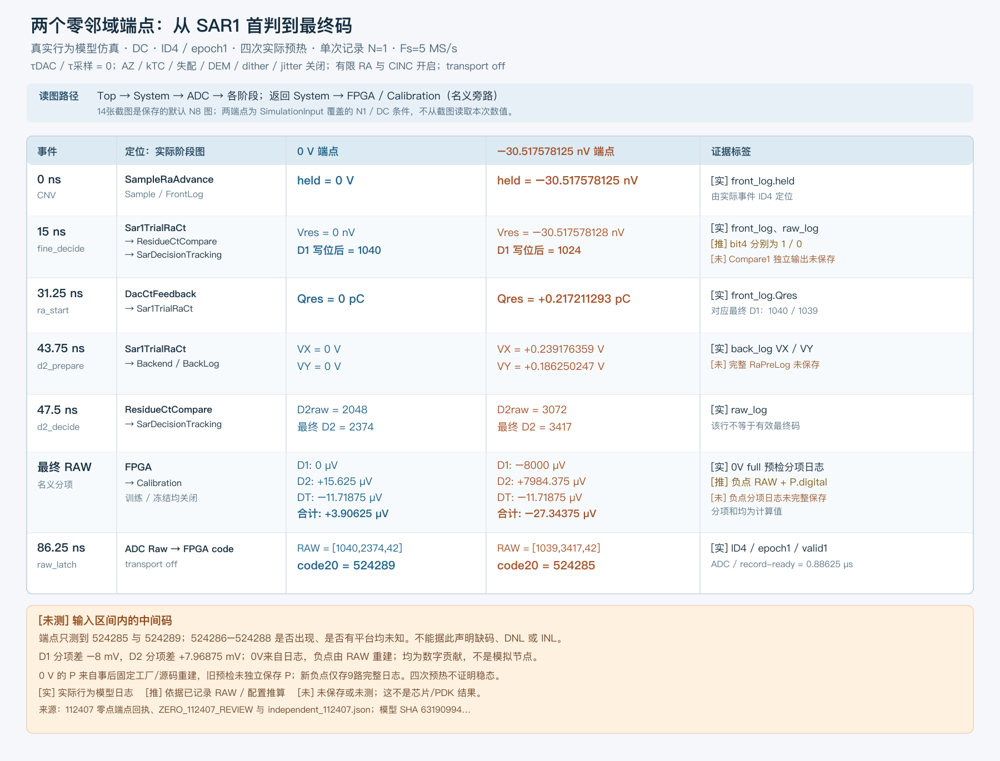

# 112407 零邻域：设计者一页事件链

`zero_event_chain.svg` 是可编辑的矢量源，`zero_event_chain.png` 是已检查的单页预览；数字来自只读复核的 [zero_full_branch_readback.json](zero_full_branch_readback.json)、[独立逐事件报告](ZERO_112407_REVIEW.md) 和 [端点物理回读](ZERO_ENDPOINT_PHYSICS.md)。绘图过程没有跑 MATLAB、修改 SLX、读取理想曲线补中间点或改写原始证据。图中 `[实]` 是已保存的行为仿真事件/日志，`[推]` 是基于已保存 RAW 与配置的重建或位值推断，`[未]` 是未保存或未测。

从当前14张导图定位：先看 [Top](/Users/zhaoyi/Obsidan/项目库/outputs/sar20_5_simulink_20261020/analysis/behavior/current_figures/Top.png) → [System](/Users/zhaoyi/Obsidan/项目库/outputs/sar20_5_simulink_20261020/analysis/behavior/current_figures/System.png) → [ADC](/Users/zhaoyi/Obsidan/项目库/outputs/sar20_5_simulink_20261020/analysis/behavior/current_figures/ADC.png)，然后查看 [SampleRaAdvance](/Users/zhaoyi/Obsidan/项目库/outputs/sar20_5_simulink_20261020/analysis/behavior/current_figures/SampleRaAdvance.png)、[Sar1TrialRaCt](/Users/zhaoyi/Obsidan/项目库/outputs/sar20_5_simulink_20261020/analysis/behavior/current_figures/Sar1TrialRaCt.png)、[ResidueCtCompare](/Users/zhaoyi/Obsidan/项目库/outputs/sar20_5_simulink_20261020/analysis/behavior/current_figures/ResidueCtCompare.png)、[SarDecisionTracking](/Users/zhaoyi/Obsidan/项目库/outputs/sar20_5_simulink_20261020/analysis/behavior/current_figures/SarDecisionTracking.png) 与 [DacCtFeedback](/Users/zhaoyi/Obsidan/项目库/outputs/sar20_5_simulink_20261020/analysis/behavior/current_figures/DacCtFeedback.png)；最后回到 System 看 [FPGA](/Users/zhaoyi/Obsidan/项目库/outputs/sar20_5_simulink_20261020/analysis/behavior/current_figures/FPGA.png) / [Calibration](/Users/zhaoyi/Obsidan/项目库/outputs/sar20_5_simulink_20261020/analysis/behavior/current_figures/Calibration.png)。Transport/RefQueue 本次关闭；不能把 RX 接收时刻代入本例。14 图是保存的默认 N8 配置，不是两端点 N1/DC 实验的参数截图。

两点仅说明 `−30.517578125 nV` 与 `0 V` 对应最终有效码 524285 和 524289；其中 524286–524288 在输入区间内部是否出现尚未测量。0 V 的 D1/D2/DT 分项来自完整 preflight 日志，按 RAW 重建可逐位复现；负点的分项日志未完整保留，故其分项由最终 RAW 与 `P.digital` 重建。两端分项均是数字值，不能画成模拟节点。0 V 旧预检未独立保存 as-run P，其 P 是从固定工厂和源码事后重建；四次真实预热不证明稳态。这些边界同样适用于图中的小数。
