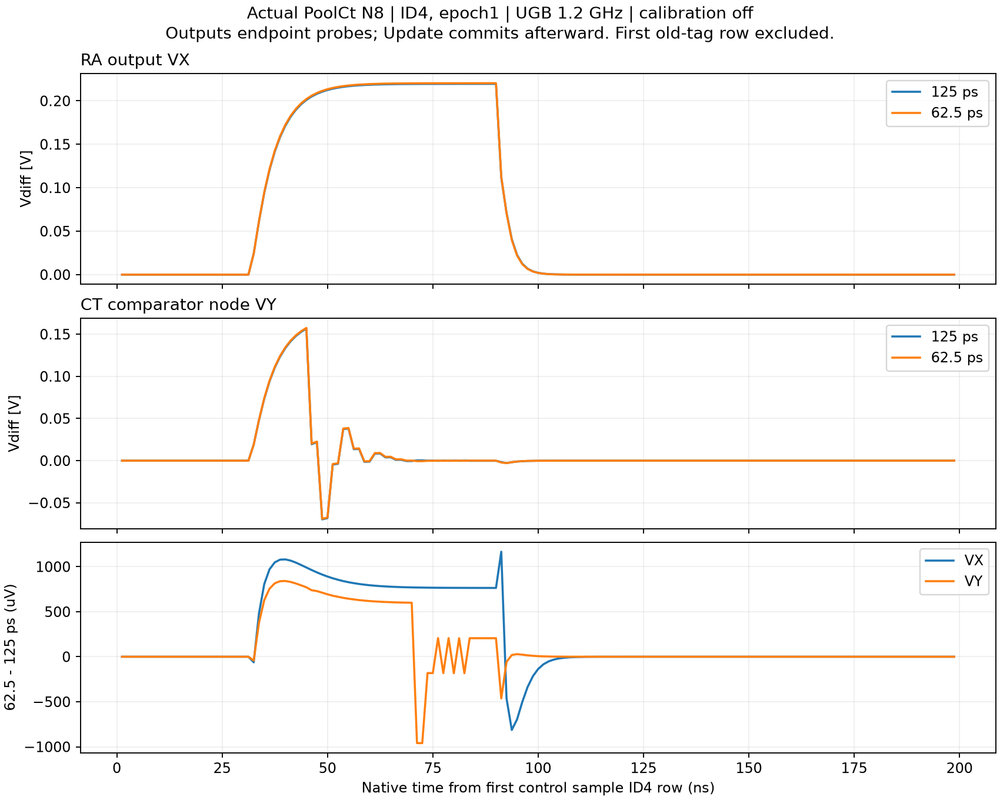

# SAR20-5 实际步长核验（2026-10-26）

本报告冻结记录缓存补丁前的步长实验；下文“当前源码”仅指该实验时的源码，不代表最新部署。后续59路全态等价性与实际计时见`../performance/REPORT.md`。唯一模型路径仍为`current/runtime_work/pool_pole_precision_trial_r1/models/PoolCt.slx`，入口`SAR20.m`，参数`config/parameters.json`。本实验M8/1.2GHz/62.5ps/N8的模型SHA为`fadd1138f9703b8a9a998be61687aebac1527f9441542a9becee59276b454741`，并非最终设计配置；Mac没有进行原生MATLAB编译/仿真。

## 一页状态

| 内容 | 本轮实际状态与证据 |
|---|---|
| 唯一运行入口 | MATLAB切换到`D:/Academic/Projects/sar20m1/SAR20`后执行`SAR20`；`SAR20('run')`使用已保存配置。改JSON先`SAR20('apply')`。直接点Run不读取JSON。 |
| 基础主通路 | 单一`pool_cached_sfun`拥有模拟状态；6位coarse与SAR1、DAC1真实残差、32倍标称RA/AZ、CINC连续时间二级、12D2、8TA/7实际更新、数字重构和LVDS均有本轮整图实际数据。6位coarse不能据此称为已确认的Flash电路。 |
| 已接入ADI功能 | 18片8采集/8转换/2备用、31×32Cu group DEM、物理tail dither及公开序列抵消、sample-kTC开启；本轮均为开启状态，不冒称关闭/开启全对照已做。 |
| 尚未接入/验证完 | 乒乓训练/冻结/独立holdout、时序偏斜与公共/局部jitter、完整非理想扫描、静态DNL/INL；独立旧352态或684参数函数不能作为整图实现证明。 |
| 旧频谱边界 | NativeCt固定A/B冻结校准101.91dB是历史结果。旧PoolCt R91/UGB1.2GHz/N256的SNDR99.608385dB、SNR99.994041dB也不是当前62.5ps的性能。N8不做FFT，未测项不填0。 |
| 唯一最关键阻断 | BE积分误差仍能改变码，减小步长又使仿真变慢；需同时闭合积分精度和执行成本，不能靠无限缩步长或把好看的旧频谱搬来验收。 |

## 真实运行与来源

旧250ps/125ps数据的输入、seed、物理参数相同，仅内部max_step不同。当前源码增加过M1支持，与旧树不是同一SHA。为此在当前唯一模型先真正跑250ps基准：54路logger的全部Data/Time、原生tout、整个selected树均逐位等于旧250ps；没有使用数值容差。此后只改同一模型的内部max_step为62.5ps，再实际运行。数值核心源码没有改动。源身份和配置检查见[engineering_check.json](engineering_check.json)，基准比较见[anchor_comparison.json](anchor_comparison.json)。

| 实际记录 | sim耗时 | 定位 |
|---|---:|---|
| 旧250ps N8 | 82.4468398s | `analysis/p0_data/be250/`，原封闭归档数据 |
| 旧125ps N8 | 110.5248622s | `analysis/p0_data/be125/`，原封闭归档数据 |
| 步长实验时源码250ps基准 | 103.3587453s | Windows `runs/run_tp37074577_fe22_47c2_b98a_f138c4b463bf`，本机`analysis/p0_data/anchor/` |
| 步长实验时源码62.5ps N8 | 208.1844647s | Windows `runs/run_tp394bdae9_7cbe_4949_9cd7_da5d4830e619`，本机`analysis/p0_data/be62p5/` |

共同条件：Fs=5MHz、输入97656.25Hz、差分峰值3.650563842595822V、相位0.731rad、offset=0、master seed20261020、ID4–11/epoch1、A0=10000、UGB=1.2GHz、校准off、F2/sample-kTC@298.15K/DEM/tail-dither开启。A0/UGB是设计假设。全局步长250ps、owner间隔1.25ns、实际采样孔径和控制事件没有改动。

| sample ID | 250ps码 | 125ps码 | 62.5ps码 |
|---|---:|---:|---:|
| 4 | 963368 | 963374 | 963377 |
| 5 | 979633 | 979637 | 979639 |
| 6 | 989053 | 989054 | 989055 |
| 7 | 991473 | 991473 | 991472 |
| 8 | 986864 | 986861 | 986860 |
| 9 | 975311 | 975306 | 975304 |
| 10 | 956966 | 956960 | 956956 |
| 11 | 932121 | 932112 | 932107 |

原始三组整数码及差值见[output_codes.csv](output_codes.csv)，从本轮MATLAB生产者结果生成；不是拟合或指定目标值。数据SHA在旧两组`PATHS.json`/`LOCAL_SHA.json`及第三组`ORIGIN.json`，当前现场模型/文件SHA见[step62_native.json](step62_native.json)。

## 观察到了什么

两次步长减半后，同孔径held电压变化的比值为0.499862–0.500758；各样本首个D2事件VY变化比为0.499074–0.510188，符合近似一阶缩减趋势。125→62.5ps的最终码差仍为`+3,+2,+1,-1,-1,-2,-4,-5`。量化和D2分支切换会使TA变化非线性，不能拿所有TA点套用单一缩减比例。详情见[physics_check.json](physics_check.json)。没有冻结的时间离散误差预算，因此报告趋势，不判“已收敛”。

下图是真实ID4/epoch1输出端点probe；Outputs计算预测端点，Update随后提交。首个控制ID4行仍带旧模拟tag，已排除；横轴0对应首个控制ID4行，首个有效模拟点约在+1.25ns。Vx/Vy是物理差分probe，CT的静态DAC投影没有混入节点误差。两臂logger行由保存的采样周期/起点/行数绑定原生tout网格；跨臂时间网格和descriptor逐位比较，descriptor与原生网格的浮点表达残差单独报告，未设新容差。



每个ID的实际检查均为5次fine、12次D2、8次TA；64组TA→下一owner状态行核对确认index0–6各更新一次、index7不再更新。D1/D2/DT、LVDS帧解包、最终整数码逐样本一致，见[interface_check.json](interface_check.json)。这不是全5181字模拟状态或电荷/KCL验收。

公开plan、DEM键、dither、capture ID/epoch/valid/aperture、可见加权sample-kTC与记录的CMP RNG状态已分项检查，见[random_check.json](random_check.json)。sample-kTC隐藏PRNG状态和支路噪声向量未记录，不能以可见标量或MATLAB全局rng未变代替该检查。

## 非理想和电容口径

本轮真正开启且有数值作用：sample-kTC、有限采集/开关建立、DAC1固定IID单位失配/寄生、有限RA A0/带宽、CT网络及数字定点舍入，以及F2的DEM/dither。AZ存储/换向和比较器决策/延迟在主图工作，但本次AZ附加噪声为0，选中记录没有超时/饱和事件，不能宣称这些损伤已被激发验证。Rref=0将参考电压固定，参考KCL负载路径存在不等于有限参考恢复已经开启；本次参考动态不计覆盖。比较器noise/offset、RA附加noise、slew限制、jitter/skew、CT main/replica失配等为0/Inf/关闭者不计本轮覆盖。DAC1 P/N电容与寄生复制相同，没有独立P/N不对称或空间梯度。逐项实际值、通用registry与F2 overlay的命名冲突、实现/开启/扫描三状态见[nonideal_check.json](nonideal_check.json)；三次步长试验不算非理想扫描。功耗/面积/工艺签核未由行为模型证明。

8片采样等效电容约27.5959pF/每个差分半边；P+N物理和约55.1918pF。充分热化且两边独立的解析参考为`σdiff=sqrt(2kT/Cside)≈17.2724µVrms`，当前差分幅值下kT/C单项SNR参考约103.49dB；这不是N8实测或SNDR。论文图标1039×27fF、正文总采样电容28pF，但未明确P/N拆分。模型将28pF取为每侧是设计假设，不能宣称电容和热噪声口径已与原文完全对齐。

## 复跑与下一步

Windows实际ADC仿真仍只经`SAR20('apply')`/`SAR20('run')`。本机重算数据图：

```sh
dependencies/analysis_env/bin/python analysis/time_step/analyze_step.py be125 be62p5
dependencies/analysis_env/bin/python analysis/time_step/compare_capture.py
```

Python只读取MAT，不产生ADC码。默认compact关闭完整模拟态/电荷日志；新N8 raw约11.6MB。完整状态物理核验应显式短记录使用physics模式，不能把未保存量宣称已验证。

下一工作只收敛积分核的精度与执行成本：先核BE的连续输入求值时刻与端点状态语义，并据本轮held/RA/CT证据确定可验证的改进；在此之前不盲目继续减小步长或声称提速。原采样时刻、12D2、8比较/7更新、随机状态边界和现有代数残差/电荷容差不变。改进后仍需同条件原始判决、码、节点及事件验证，再回到至少256码动态、实际静态跃迁和ADI校准/非理想闭环。
