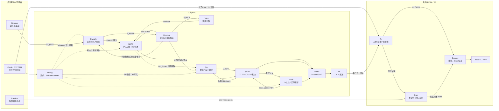

> 历史设计草案：2026-10-27已建立并实际运行新的行为模型。当前接口和验证范围以根目录README、current/src及CHECKPOINT为准；本文包含未实施设想，不作为当前集成/运行证明。

# SAR20 行为主图与单样本观察契约

这是下一次建图的建议契约，尚未接入当前模型。目标是让设计者沿一个 sample 看清采样、判决、残差、跟踪与重构；优先明确模块状态和事件，不以内部矩阵或数值残差作为主图语言。继续使用唯一入口 `SAR20.m`，不增加版本入口。

Timing/SAR sequencer在片内；片外只提供Clock/CNV/EN控制引脚。虚线代表控制事件，不为每个模块添加独立时钟。SAR1必须逐次闭合trial→DAC1/Residue→CMP1→SAR1，D1_done后才把完成时的实际残差交给RA；CT/DAC2的负载与kickback返回RA。转换释放后，采样电容保留电荷经明确的释放/重接事件进入下一采集，不能每次把记忆设成上次Vin。片内观察信号只送只读观察器；内部理想值、节点或隐含状态不进入功能Decode或训练参考。Train未实现时显示 `off`，现有内部Reference审计不等于外部训练。

| 短名 | 责任、主要接口与可见状态 |
|---|---|
| Stimulus / Timing | Stimulus输出 `vin_p/n [V]`；外部Clock/CNV/EN驱动片内Timing，由其排交织、trial、比较、AZ及释放事件。噪声/抖动仅在声明的事件抽样，保留seed与启停项。 |
| Sample | 18片资源分配、8采集/8转换/2备用、保持及孔径；唯一持有各片采样电荷状态，转换释放时接回实际保留电荷，再按驱动建立进入下一采集。输出 `v_hold [V]`、内部slice/id/epoch和capture_valid。 |
| SAR1 / CMP1 | PreADC粗判决后，每次trial都更新DAC1、等待残差建立并由CMP1反馈判决，最终产生D1/d1_done。D1沿用raw ABI；“6位coarse”不确认Flash电路。 |
| Residue | 依据trial开关、采样保留电荷、DEM、tail dither及失配形成实际 `v_res [V]`；D1_done时供RA使用。与Sample共享的电荷只存一份，以事件交接，不重复积分。 |
| RA | 残差放大、有限增益/建立、AZ写入与保持；显式接收CT/DAC2负载与kickback，输出 `v_ra [V]`，可看az状态。A0/UGB为设计假设。 |
| SAR2 | CT/DAC2状态和12次D2判决；输出D2、`v_x/v_y [V]`、比较事件及对RA的负载/kickback反馈。唯一拥有CT节点状态，Track只提交更新命令。 |
| Track | 接收比较结果，执行TA时序与跟踪控制，输出 `DT`、`track_update`；M8明确为8次比较、7次实际更新，末次比较不再更新。 |
| Frame / Tx / Rx | Frame汇集D1/D2/DT，Tx/Rx按现有公开协议发送/接收；Frame模式Rx的id/epoch由公开CNV/EN计数恢复，不把内部sample_id/epoch当wire数据，不新增隐藏sideband。 |
| Decode / Train | Decode以公开接收帧、公开dither序列和系数重构；Train按外部xref的id/epoch配对，分训练/冻结/独立holdout。`code20`才是20位整数；现有`Code18`是18字段ABI，不是18位码。 |

片内观察记录与Rx本地记录各自使用 `data + sample_id + epoch + valid`，两者的标签来源独立，不能据此增加线上标签字段。观察事件另带 `event_kind / event_index / time_s`；ID/epoch/计数无量纲，时间s，节点V。D1/D2/DT注明raw字段/判决序列、数据类型、范围和顺序。`ctrl[33]`、`record[11]`、`Code18[18 fields]`只是内部ABI短名；code20才表示20位码，详细字段放子系统内。

**观察一个 sample：** 按 `(sample_id, epoch)`选择一次转换，显示 `capture → PreADC → SAR1 trial/残差建立/CMP1各次判决 → d1_done → RA/AZ → D2[1…12] → TA[1…8]/update[1…7] → release/下次acquire`，并关联tx/rx完成与code_valid。事件可重叠，以片内Timing和公开引脚时间戳为准。并排显示D1/D2/DT、`v_hold/v_res/v_ra/v_x/v_y/az [V]`、释放前后保留电荷与slice/chop/DEM/dither标签，检查Rx独立计数标签是否匹配。观察器只读、不抽随机数、不改valid或反馈；未记录量不补画。

模块内部先用标准Bus、Sum/Gain、Switch、Compare、Delay/Memory和显式触发子系统表达；采样保持、RA建立与CT状态各有唯一状态归属。复杂判决/系数计算可保留少量短行为核，函数只负责一件事并公开输入输出，避免一个黑箱同时拥有调度、全部模拟状态和数字重构。

来源边界：用户 `SIMSAR.zip/SIMSAR/simsar.slx` 的真实XML将Stimulus、`SAR_ADC`、`Outputs generation`分层，ADC内继续分 `CDAC Noise`、`Comparator`、`DAC Model`、`State Machine`；此处借鉴其职责分层与明确接口名，不声称其电路等同SAR20。当前PoolCt顶层真实XML含 `Stimulus/Adc/Transmit/Receive/Reconstruct`；本图是在此数据流上展开行为职责的建议，不代表新图、外部训练或各非理想项已经实现/验收。
